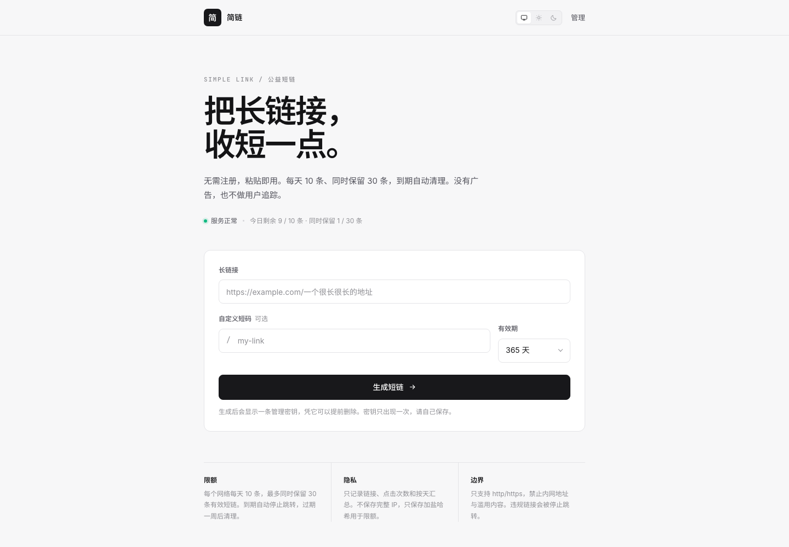

# 简链

一个可以部署在 Cloudflare Workers 上的公益短链接服务。无需注册，粘贴即用；每天 10 条、同时保留 30 条；没有广告，也不做用户追踪。

界面和「简单博客」共用一套黑白设计：同一组颜色变量、同样的 Inter / JetBrains Mono 字体、同样的留白和边框。纯 HTML / CSS / JavaScript，没有前端框架和第三方统计脚本。

在线实例：<https://s.wn.tn>。源码：<https://github.com/usxs/simple-link>。

<p>
  
  
</p>

## 功能

- 生成 7 位随机短码，或自定义 3–32 位短码（字母、数字、`-`、`_`）
- 有效期 1 / 7 / 30 / 365 天，可配置；到期返回 410，过期一周后自动清理
- 每日限额 + 同时保留限额，按访问者 IP 的加盐哈希计数，不保存原始 IP
- 每个短链生成一条管理密钥，凭密钥可提前删除；服务端只保存密钥哈希
- `/<短码>+` 统计页：累计点击、最近 14 天柱状图、创建/到期/最近点击时间
- 可选管理后台 `/admin`：查看全站短链、搜索、屏蔽、删除
- 可选「简单博客」账号登录：博客已登录时自动单点登录；也保留管理令牌作为应急入口
- 可选 Cloudflare Turnstile 人机验证，防止脚本刷额度
- 自动 / 浅色 / 深色三档主题，跟随系统，选择记在 localStorage
- 移动端适配、键盘可操作、减少动效偏好、CSP 与安全响应头
- 定时任务清理过期数据，D1 单库，无其他依赖

<p>
  
  
</p>

## 技术结构

```
URL/
├── src/
│   ├── index.js      Worker 入口：路由、跳转、静态资源、定时清理
│   ├── api.js        /api/*：生成、查询、删除、统计、管理
│   ├── pages.js      统计页与错误页的服务端渲染
│   ├── http.js       CSP、安全头、JSON / HTML 响应
│   ├── sso.js        简单博客单点登录桥接、短时令牌、未登录页
│   ├── validate.js   目标地址与短码校验、内网地址拦截
│   └── util.js       时区、哈希、随机串、HTML 转义
├── public/           纯静态前端（HTML / CSS / 原生 JS）
├── migrations/       D1 建表 SQL
├── wrangler.jsonc    Worker、静态资源、D1、Cron 配置
└── docs/screenshots  README 截图
```

请求路径：

- `GET /<短码>`：302 跳转并异步记一次点击
- `GET /<短码>+`：公开统计页
- `/api/*`：生成、配额、查询、删除、统计、管理接口
- 其余路径：交给静态资源，未命中返回 404 页面

数据表：`links`（短链）、`link_clicks_daily`（按天点击）、`link_quota`（按 IP 哈希的每日额度）。

## 部署

需要 Node.js 20+、pnpm、一个 Cloudflare 账号。以下命令都在 `URL/` 目录执行。

仓库里的 `wrangler.jsonc` 已经填写线上实例的 D1 ID、自定义域名 `s.wn.tn` 和博客 SSO 路由。**自部署时请先换成自己的 D1、域名和博客地址**，否则会连到本项目使用的资源。

### 1. 安装依赖

```bash
pnpm install
pnpm exec wrangler login
```

### 2. 创建 D1 数据库

```bash
pnpm exec wrangler d1 create simple-link
```

命令会输出 `database_id`。打开 `wrangler.jsonc`，把 `database_id` 换成这一串 ID。

### 3. 建表

```bash
pnpm db:migrate
```

脚本等价于 `wrangler d1 migrations apply simple-link --remote`。首次部署时执行一次即可；以后新增 migration 再执行。

### 4. 配置密钥

```bash
pnpm exec wrangler secret put IP_SALT
```

`IP_SALT` 用来对访客 IP 做加盐哈希，请填一段足够长的随机字符串（例如 `openssl rand -hex 32` 的输出）。**上线后不要随意更换**，否则同一访客的历史额度和新额度会对不上。

管理后台是可选的。最简单的方式是设置一个管理令牌：

```bash
pnpm exec wrangler secret put ADMIN_TOKEN
```

`ADMIN_TOKEN` 和 `BLOG_ORIGIN` 都不设置时，`/admin` 和 `/api/admin/*` 自动关闭；只设置其中一个也可以登录。

如果要接入「简单博客」账号，再设置两项：

```bash
pnpm exec wrangler secret put BLOG_SSO_SECRET
```

`BLOG_SSO_SECRET` 填一段足够长的随机字符串（例如 `openssl rand -hex 32` 的输出），用于加密一次性的 SSO 跳转令牌，**不要和管理令牌或博客的密钥共用**。然后在 `wrangler.jsonc` 里把 `BLOG_ORIGIN` 改成博客 API 的源，例如 `https://api.starspace.cc`。

博客的会话 Cookie（`console_session`）是 host-only 且 `SameSite=Strict`，短链域名读不到。因此需要在**博客 API 的域名**上把路径 `/__simple_link_sso` 路由到本 Worker，让浏览器带着博客 Cookie 访问这个地址，再由 Worker 调博客的 `/api/auth/status` 验证并跳回短链域名。`wrangler.jsonc` 中的示例：

```jsonc
"BLOG_ORIGIN": "https://api.starspace.cc",
"routes": [
  { "pattern": "s.wn.tn", "custom_domain": true },
  { "pattern": "api.starspace.cc/__simple_link_sso", "zone_name": "starspace.cc" }
]
```

如果博客 API 和短链在同一个域名，或你的部署工具没有 Workers Routes 权限，可以去掉第二条，改为在 Cloudflare 控制台手动添加同样的 Route。Route 生效需要几秒到几十秒，首次访问若短暂 404 可以稍后再试。

### 5. 按需调整公开配置

编辑 `wrangler.jsonc` 里的 `vars`，重新部署后生效：

| 变量 | 默认值 | 说明 |
| --- | --- | --- |
| `TIMEZONE` | `Asia/Shanghai` | 每日额度和统计图按此时区切分 |
| `DAILY_LINK_LIMIT` | `10` | 每个 IP 每天最多生成条数，`0` 表示不限制 |
| `ACTIVE_LINK_LIMIT` | `30` | 每个 IP 同时保留的有效短链数 |
| `DEFAULT_TTL_DAYS` | `365` | 默认有效期 |
| `MAX_TTL_DAYS` | `365` | 允许的最长有效期 |
| `PUBLIC_ORIGIN` | 空 | 强制短链域名，例如 `https://s.example.com`；留空跟随访问域名 |
| `TURNSTILE_SITE_KEY` | 空 | Turnstile 站点密钥；和 `TURNSTILE_SECRET` 同时存在才启用 |
| `BLOCKED_HOSTS` | 空 | 禁止缩短的域名，逗号分隔，子域名一并拦截 |
| `BLOG_ORIGIN` | 空 | 简单博客 API 的源，例如 `https://api.starspace.cc`；用于账号登录和 SSO |
| `BLOG_COOKIE_DOMAIN` | 空 | 博客和简链共用可注册域名时，退出时顺便清除博客 Cookie，例如 `.wn.tn`；一般留空 |
| `SIBLING_URL` | 空 | 页脚的「随机邮箱」入口 |
| `BLOG_URL` | 空 | 页脚的「简单博客」入口 |
| `REPO_URL` | 空 | 页脚的「源码」入口 |

例如把三个链接都填上：

```jsonc
"SIBLING_URL": "https://mail.example.com",
"BLOG_URL": "https://blog.example.com",
"REPO_URL": "https://github.com/you/simple-link"
```

### 6. 部署

```bash
pnpm deploy
```

首次访问分配的 `*.workers.dev` 域名即可使用。定时清理任务会随部署自动注册，UTC 03:41（北京时间 11:41）执行。

如果使用仓库里现成的 `routes`，部署时还需要有 Workers Routes 权限；只有 Worker 上传权限时，脚本会部署成功，但路由会报 `No access to the specified resource`。这时可以用有 DNS / Routes 权限的令牌在控制台或 API 里补上 `s.wn.tn` 和 `api.starspace.cc/__simple_link_sso` 两条路由，不影响已经上传的 Worker。

### 7. 绑定自定义域名（可选）

域名需要已经托管在同一个 Cloudflare 账号下。在 `wrangler.jsonc` 末尾取消注释并修改：

```jsonc
"routes": [
  { "pattern": "s.example.com", "custom_domain": true }
],
```

然后重新 `pnpm deploy`。如果希望所有短链都固定使用这个域名，同时把 `PUBLIC_ORIGIN` 设为 `https://s.example.com`，避免从 `workers.dev` 访问时生成另一套域名。

## 本地开发

```bash
cp .dev.vars.example .dev.vars
pnpm db:migrate:local
pnpm dev
```

打开 `http://127.0.0.1:8787`。本地 D1 数据存放在 `.wrangler/` 下。

`.dev.vars` 至少要有 `IP_SALT`；想测试后台就填 `ADMIN_TOKEN`。这两个文件都被 `.gitignore` 忽略，不要提交。

常用命令：

```bash
pnpm db:migrate:local   # 本地建表
pnpm db:migrate         # 远程建表
pnpm check              # 打包检查，不真正部署
pnpm tail               # 实时日志
```

## 开启 Turnstile

1. 在 Cloudflare 控制台进入 **Turnstile**，添加站点，域名填短链域名。
2. 把站点密钥填到 `wrangler.jsonc` 的 `TURNSTILE_SITE_KEY`。
3. 执行 `pnpm exec wrangler secret put TURNSTILE_SECRET`，填入密钥。
4. 重新部署。首页表单会出现人机验证，服务端会校验 `action === "shorten"`。

只填其中一个不会生效。Turnstile 失败或超时会拒绝创建，不会扣减额度。

## 管理后台

访问 `/admin`。配置了 `BLOG_ORIGIN` 和 `BLOG_SSO_SECRET` 时，页面会先尝试用「简单博客」的登录状态自动登录：

- 博客已经登录：自动跳转、验证、回到简链后台，不需要再输密码。
- 博客没有登录：显示「还差一步」，可以去博客后台登录，也可以点「使用管理令牌登录」回到 `/admin?local=1`。
- 也可以在登录页直接用博客用户名和密码登录；开启了两步验证时会继续要求 TOTP。
- 管理令牌登录仍然保留，令牌只存在当前标签页的 `sessionStorage`，关闭标签页即失效。

后台可以查看全站短链、按短码或目标地址搜索、屏蔽（立即返回 451）、解除屏蔽、删除。删除不可恢复。

登录成功后简链会设置一个 `HttpOnly`、`SameSite=Lax` 的 `sl_admin` Cookie，默认 7 天有效；它只用于简链后台，不会读写博客的其他数据。退出时会尽力清除简链 Cookie；博客自己的会话是否退出由博客控制。

如果公开部署，建议同时开启 Turnstile，并设置足够长的 `ADMIN_TOKEN` / `BLOG_SSO_SECRET`。后台页面已在 `robots.txt` 中禁止抓取，但这不能替代访问控制。

## 隐私与边界

- 只记录短链、目标地址、创建时间、到期时间、点击次数、按天点击数、创建者 IP 的加盐哈希、管理密钥哈希。
- 不记录原始 IP、User-Agent、Referer，不接第三方统计。公开页面不写 Cookie；只有登录后台成功后才设置一个用于后台会话的 `sl_admin` Cookie。
- 点击计数按天汇总；统计页展示最近 14 天，不提供访客明细。
- 只接受 `http` / `https` 目标；拒绝内网、本机、云元数据地址和带账号密码的 URL；拒绝把短链指向自己。
- 短码是公开的，任何拿到链接的人都能访问。请不要用它缩短隐私内容或一次性凭证。
- 管理密钥只显示一次；丢失后无法找回，只能等链接到期或让管理员在后台删除。
- 限额按 IP 哈希计算，NAT、公司网络、校园网下的多个用户会共用额度。这是公益服务的取舍，不是精确的实名限制。

## 运维

- 过期短链在到期 7 天后删除，同时删除它的按天点击记录。
- `link_quota` 保留 60 天，之后由定时任务清理。
- 备份 D1：`pnpm exec wrangler d1 export simple-link --remote --output backup.sql`。
- 日志：`pnpm tail`；也可以在 Cloudflare 控制台的 Workers 日志里查看。
- 免费套餐足够小规模公益使用；如果流量增长，注意 D1 读写行数和 Workers 请求数。

## 设计说明

颜色、圆角、字体、按钮和主题切换都对齐 `blog-cms/backend/web/style.css` 的 token：

- 浅色：画布 `#F7F7F8`、卡片 `#FFFFFF`、正文 `#141416`、边框 `#E4E4E7`
- 深色：画布 `#101012`、卡片 `#161618`、正文 `#F4F4F5`、边框 `#27272A`
- 8px 圆角、1px 边框、Inter / Noto Sans SC / JetBrains Mono
- 主按钮是黑底白字，深色主题下反转为白底黑字
- 只在服务状态处使用绿色，其余保持黑白灰

主题模式存在 `localStorage` 的 `simple-link-theme`，和博客一样支持自动 / 浅色 / 深色。

## 截图

| 页面 | 文件 |
| --- | --- |
| 首页 · 浅色 | `docs/screenshots/home-light.png` |
| 首页 · 深色 | `docs/screenshots/home-dark.png` |
| 首页 · 移动端 | `docs/screenshots/home-mobile.png` |
| 生成结果 | `docs/screenshots/result-light.png` |
| 短链统计 | `docs/screenshots/stats-light.png` |
| 管理后台 | `docs/screenshots/admin-light.png` |

截图来自本地 `wrangler dev`，所以地址栏和结果里是 `127.0.0.1`。线上实例会自动换成 `s.wn.tn`。

## 许可

可自由使用、修改和自部署。如果这个项目和「简单博客」一起使用，页脚可以互相链接。
