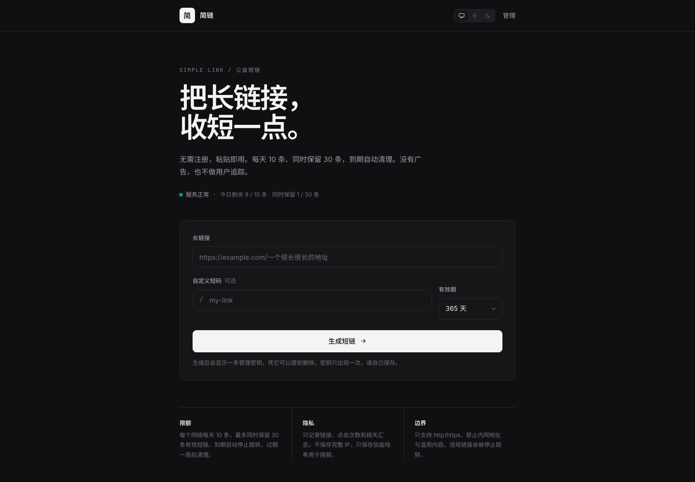
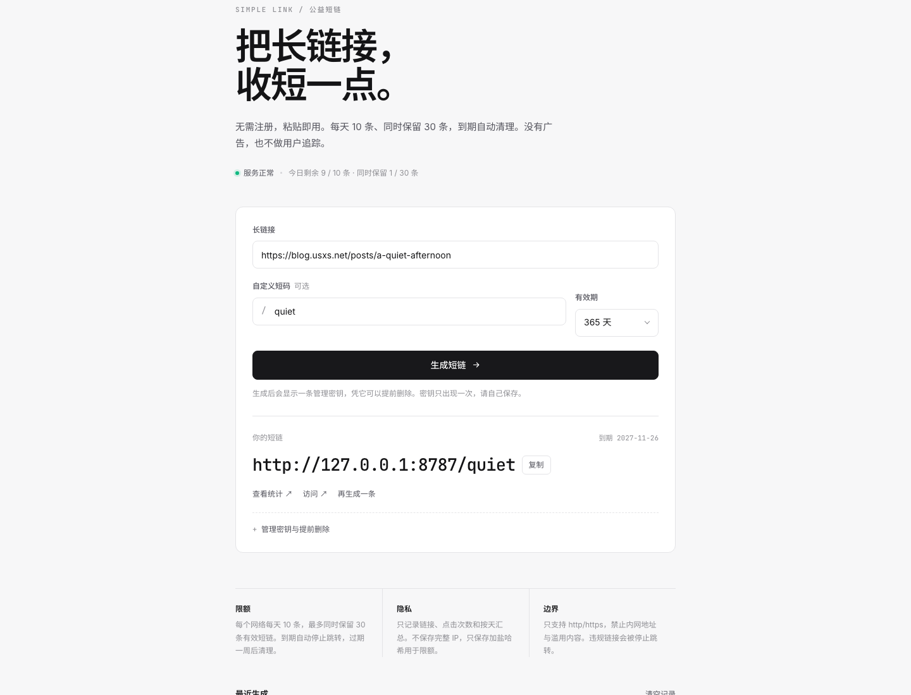
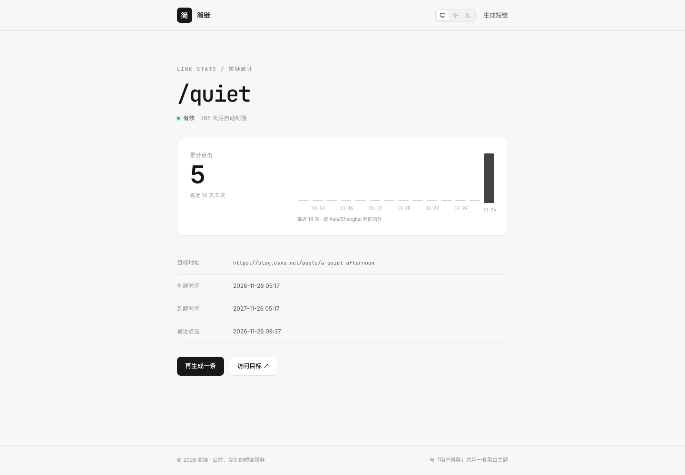

# 简链

一个可以部署在 Cloudflare Workers 上的公益短链接服务。无需注册，粘贴即用；每天 10 条、同时保留 30 条；没有广告，也不做用户追踪。

界面和「简单博客」共用一套黑白设计：同一组颜色变量、同样的 Inter / JetBrains Mono 字体、同样的留白和边框。纯 HTML / CSS / JavaScript，没有前端框架和第三方统计脚本。

在线实例：<https://s.wn.tn>。源码：<https://github.com/usxs/simple-link>。

[](https://deploy.workers.cloudflare.com/?url=https://github.com/usxs/simple-link)

<p>
  
  
</p>

## 功能

- 生成 7 位随机短码，或自定义 3–32 位短码（字母、数字、`-`、`_`）
- 有效期 1 / 7 / 30 / 365 天，可配置；到期返回 410，过期一周后自动清理
- 每日限额 + 同时保留限额，按访问者 IP 的加盐哈希计数，不保存原始 IP
- 一个浏览器一份「管理密钥」，凭它在 `/manage` 管理自己创建的所有短链
- 每条短链仍有一条独立删除密钥，适合只删某一条链接
- `/<短码>+` 统计页：累计点击、最近 14 天柱状图、创建/到期/最近点击时间
- 管理后台 `/admin`：管理令牌、用户名密码、通行密钥（Passkey）、简单博客单点登录
- 管理后台可查看全站短链、搜索、屏蔽、解除屏蔽、删除
- 简单博客 SSO 默认关闭；没有部署博客也可以独立使用
- 可选 Cloudflare Turnstile 免费人机验证，防止脚本刷额度
- 自动 / 浅色 / 深色三档主题，跟随系统，选择记在 localStorage
- 移动端适配、键盘可操作、减少动效偏好、CSP 与安全响应头
- 定时任务清理过期数据，D1 单库，无其他依赖

<p>
  
  
</p>

## 技术结构

```
URL/
├── src/
│   ├── index.js      Worker 入口：路由、跳转、静态资源、定时清理
│   ├── api.js        /api/*：生成、查询、删除、统计、管理与通行密钥
│   ├── auth.js       管理员会话、账密、所有者密钥、Cookie 与 HMAC
│   ├── passkeys.js   零依赖 WebAuthn 注册与登录校验
│   ├── pages.js      统计页与错误页的服务端渲染
│   ├── http.js       CSP、安全头、JSON / HTML 响应
│   ├── sso.js        简单博客单点登录桥接、短时令牌、未登录页
│   ├── validate.js   目标地址与短码校验、内网地址拦截
│   └── util.js       时区、哈希、随机串、HTML 转义
├── public/           纯静态前端（HTML / CSS / 原生 JS）
├── migrations/       D1 建表 SQL
├── wrangler.jsonc    一键部署/自部署默认配置
├── wrangler.production.jsonc  本项目的线上配置（仅作者使用）
└── docs/screenshots  README 截图
```

请求路径：

- `GET /<短码>`：302 跳转并异步记一次点击
- `GET /<短码>+`：公开统计页
- `GET /manage`：用管理密钥管理自己创建的短链
- `GET /admin`：管理员后台
- `/api/*`：生成、配额、查询、删除、统计、管理与登录接口
- 其余路径：交给静态资源，未命中返回 404 页面

数据表：`links`（短链与所有者哈希）、`link_clicks_daily`（按天点击）、`link_quota`（每日额度）、`admin_sessions`、`admin_passkeys`、`admin_login_attempts`。

## 部署

需要 Node.js 20+、pnpm、一个 Cloudflare 账号。以下命令都在 `URL/` 目录执行。

### 方式一：一键部署（推荐）

点上面的 **Deploy to Cloudflare** 按钮。Cloudflare 会：

1. 把仓库复制到你自己的 GitHub 账号；
2. 按 `wrangler.jsonc` 自动创建 D1 数据库并把占位 ID 换成真实 ID；
3. 自动执行 D1 migration 和 `wrangler deploy`；
4. 分配一个 `https://simple-link.<你的子域>.workers.dev` 地址。

部署完成后，到 **Workers & Pages → simple-link → Settings → Variables and Secrets** 添加：

| 名称 | 类型 | 必填 | 说明 |
| --- | --- | --- | --- |
| `IP_SALT` | Secret | 是 | 随机长字符串，用于 IP 哈希；上线后不要改 |
| `ADMIN_TOKEN` | Secret | 否 | 管理令牌；不设置就没有令牌登录 |
| `ADMIN_USERNAME` | Secret/变量 | 否 | 管理员用户名，默认 `admin` |
| `ADMIN_PASSWORD` | Secret | 否 | 管理员密码；和用户名一起启用账密登录 |
| `TURNSTILE_SECRET` | Secret | 否 | Turnstile 私钥；和站点密钥同时设置才启用 |

生成随机值可以用：

```bash
openssl rand -hex 32
```

一键部署默认不带自定义域名，直接用 `workers.dev` 地址即可。想换域名见下文「自定义域名」。

> 如果你想部署的是本项目的线上实例，请使用 `wrangler.production.jsonc`，不要用根配置覆盖 `s.wn.tn` 的生产资源。

### 方式二：手动部署

```bash
git clone https://github.com/usxs/simple-link.git
cd simple-link
pnpm install
pnpm exec wrangler login

# 创建 D1，把输出的 database_id 填进 wrangler.jsonc
pnpm exec wrangler d1 create simple-link

# deploy 会先跑 migration，再上传 Worker
pnpm deploy
```

`wrangler.jsonc` 里的 `database_id` 是给一键部署占位用的全零 UUID。手动部署时务必换成 `wrangler d1 create` 返回的真实 ID。

只建表、不部署：

```bash
pnpm db:migrate
```

它等价于 `wrangler d1 migrations apply DB --remote`，使用 binding 名而不是数据库名，方便一键部署复用。

### 自定义域名

一键部署后，在 Cloudflare 控制台的 **Workers & Pages → simple-link → Settings → Domains & Routes** 添加自定义域名即可。也可以把根配置改成：

```jsonc
"routes": [
  { "pattern": "s.example.com", "custom_domain": true }
]
```

再执行 `pnpm exec wrangler deploy`。如果希望生成的所有短链都固定使用这个域名，把 `PUBLIC_ORIGIN` 设为 `https://s.example.com`；留空则跟随当前访问域名。

### 公开配置

在 `wrangler.jsonc` 的 `vars` 中调整，重新部署后生效：

| 变量 | 默认值 | 说明 |
| --- | --- | --- |
| `TIMEZONE` | `Asia/Shanghai` | 每日额度和统计图按此时区切分 |
| `DAILY_LINK_LIMIT` | `10` | 每个 IP 每天最多生成条数，`0` 表示不限制 |
| `ACTIVE_LINK_LIMIT` | `30` | 每个 IP 同时保留的有效短链数 |
| `DEFAULT_TTL_DAYS` | `365` | 默认有效期 |
| `MAX_TTL_DAYS` | `365` | 允许的最长有效期 |
| `PUBLIC_ORIGIN` | 空 | 强制短链域名，例如 `https://s.example.com`；留空跟随访问域名 |
| `TURNSTILE_SITE_KEY` | 空 | Turnstile 站点密钥；和 `TURNSTILE_SECRET` 同时存在才启用 |
| `BLOCKED_HOSTS` | 空 | 禁止缩短的域名，逗号分隔，子域名一并拦截 |
| `BLOG_ORIGIN` | 空 | 简单博客 API 的源，例如 `https://api.example.com` |
| `BLOG_SSO_ENABLED` | `false` | 是否显示并启用「简单博客」登录；默认关闭 |
| `BLOG_COOKIE_DOMAIN` | 空 | 博客和简链共用可注册域名时，退出时顺便清除博客 Cookie，例如 `.wn.tn`；一般留空 |
| `SIBLING_URL` | 空 | 页脚的「随机邮箱」入口 |
| `BLOG_URL` | 空 | 页脚的「简单博客」入口 |
| `REPO_URL` | 空 | 页脚的「源码」入口 |

### 配置简单博客单点登录（可选）

默认不启用，避免没有部署博客的人看到无法使用的入口。需要同时满足：

1. `BLOG_SSO_ENABLED=true`；
2. 设置 `BLOG_ORIGIN`，例如 `https://api.starspace.cc`；
3. 设置 secret `BLOG_SSO_SECRET`（随机长字符串，和博客自己的密钥分开）；
4. 在**博客 API 的域名**上把路径 `/__simple_link_sso` 路由到简链 Worker。

博客的会话 Cookie（`console_session`）是 host-only 且 `SameSite=Strict`，短链域名读不到。因此需要让浏览器带着博客 Cookie 访问博客域名上的 `/__simple_link_sso`，由 Worker 调博客的 `/api/auth/status` 验证，再跳回短链域名。Route 示例：

```jsonc
"routes": [
  { "pattern": "s.example.com", "custom_domain": true },
  { "pattern": "api.example.com/__simple_link_sso", "zone_name": "example.com" }
]
```

如果博客 API 和短链在同一个域名，或你的部署工具没有 Workers Routes 权限，可以去掉第二条，改为在 Cloudflare 控制台手动添加同样的 Route。Route 生效需要几秒到几十秒。

## 本地开发

```bash
cp .dev.vars.example .dev.vars
pnpm db:migrate:local
pnpm dev
```

打开 `http://127.0.0.1:8787`。本地 D1 数据存放在 `.wrangler/` 下。

`.dev.vars` 至少要有 `IP_SALT`；想测试后台就填 `ADMIN_TOKEN` 或 `ADMIN_PASSWORD`。这两个文件都被 `.gitignore` 忽略，不要提交。

常用命令：

```bash
pnpm db:migrate:local   # 本地建表
pnpm db:migrate         # 远程建表
pnpm deploy             # 建表 + 部署
pnpm check              # 打包检查，不真正部署
pnpm tail               # 实时日志
```

## 开启 Turnstile

Turnstile 的免费额度足够个人和小型公益站使用。

1. 在 Cloudflare 控制台进入 **Turnstile → Add site**，域名填短链域名；`workers.dev` 地址和自定义域名都加上。
2. 把 **Site Key** 填到 `wrangler.jsonc` 的 `TURNSTILE_SITE_KEY`，或在一键部署后的 Worker 变量里添加。
3. 执行 `pnpm exec wrangler secret put TURNSTILE_SECRET`，填入 **Secret Key**；也可以在控制台添加同名 Secret。
4. 重新部署或等待新版本生效。首页表单会出现人机验证，服务端校验 `action === "shorten"`。

只填其中一个不会生效。Turnstile 失败或超时会拒绝创建，不会扣减额度。

## 用户管理与管理员后台

### 普通用户：`/manage`

第一次生成短链时，简链会给这个浏览器分配一份**总管理密钥**，并在结果页显示一次：

- 服务端同时设置 `HttpOnly` 的 `sl_owner` Cookie，有效期 365 天；同一个浏览器之后创建的链接都会归到这份密钥下。
- 密钥同时存在浏览器的 localStorage，换标签页或重新打开 `/manage` 仍可使用。
- 在 `/manage` 输入密钥，可以查看自己创建的所有链接、屏蔽、解除屏蔽、删除。
- 这不是浏览器指纹，也不采集设备信息；只是「密钥 + Cookie」的归属方式。换浏览器或清除站点数据后，需要重新输入密钥。
- 密钥只显示一次，服务端只保存它的 SHA-256 哈希。丢失后无法找回，只能让管理员在后台删除对应链接。
- 每条链接仍会显示一条独立的单条删除密钥，用于只删除某一条；它和总管理密钥不是同一个东西。

### 管理员：`/admin`

管理后台支持四种登录方式，按配置显示：

1. **用户名密码**：设置 `ADMIN_USERNAME`（默认 `admin`）和 `ADMIN_PASSWORD`。
2. **管理令牌**：设置 `ADMIN_TOKEN`；适合应急和脚本调用。
3. **通行密钥（Passkey）**：先用前两种方式登录，在后台「通行密钥」里注册；之后可以用系统指纹、Face ID 或安全密钥登录。私钥留在设备上，服务端只保存公钥。
4. **简单博客单点登录**：仅在 `BLOG_SSO_ENABLED=true` 且配置好博客后显示。默认关闭，不会自动跳转。

登录成功后服务端签发本地 `sl_admin` 会话，写入 D1 的 `admin_sessions`，默认 7 天有效；Cookie 为 `HttpOnly`、`SameSite=Lax`，HTTPS 下带 `Secure`。退出时删除服务端会话并清除 Cookie。

后台可以查看全站短链、按短码或目标地址搜索、屏蔽（立即返回 451）、解除屏蔽、删除。删除不可恢复。

如果公开部署，建议至少设置一个强 `ADMIN_TOKEN` 或长密码，并在公开前开启 Turnstile。后台页面已在 `robots.txt` 中禁止抓取，但这不能替代访问控制。

## 隐私与边界

- 只记录短链、目标地址、创建时间、到期时间、点击次数、按天点击数、创建者 IP 的加盐哈希、所有者密钥哈希、管理密钥哈希。
- 管理员登录会记录会话、通行密钥公钥，以及失败登录的 IP 哈希和时间，用于限流；不记录原始 IP、User-Agent、Referer。
- 公开页面不写业务 Cookie。首次生成短链后设置 `sl_owner`，管理员登录后设置 `sl_admin`；两者都是 HttpOnly。
- 浏览器 localStorage 只保存主题、最近生成的链接、总管理密钥；不会上传到第三方。
- 点击计数按天汇总；统计页展示最近 14 天，不提供访客明细。
- 只接受 `http` / `https` 目标；拒绝内网、本机、云元数据地址和带账号密码的 URL；拒绝把短链指向自己。
- 短码是公开的，任何拿到链接的人都能访问。请不要用它缩短隐私内容或一次性凭证。
- 限额按 IP 哈希计算，NAT、公司网络、校园网下的多个用户会共用额度。这是公益服务的取舍，不是精确的实名限制。
- Turnstile 由 Cloudflare 提供，可能设置其自己的 Cookie；简链只把一次性的验证 token 发给 Cloudflare 校验。

## 运维

- 过期短链在到期 7 天后删除，同时删除它的按天点击记录。
- `link_quota` 保留 60 天，之后由定时任务清理。
- 管理员会话和过期通行密钥挑战会由同一定时任务清理。
- 备份 D1：`pnpm exec wrangler d1 export simple-link --remote --output backup.sql`。
- 日志：`pnpm tail`；也可以在 Cloudflare 控制台的 Workers 日志里查看。
- 免费套餐足够小规模公益使用；如果流量增长，注意 D1 读写行数和 Workers 请求数。

## 设计说明

颜色、圆角、字体、按钮和主题切换都对齐 `blog-cms/backend/web/style.css` 的 token：

- 浅色：画布 `#F7F7F8`、卡片 `#FFFFFF`、正文 `#141416`、边框 `#E4E4E7`
- 深色：画布 `#101012`、卡片 `#161618`、正文 `#F4F4F5`、边框 `#27272A`
- 8px 圆角、1px 边框、Inter / Noto Sans SC / JetBrains Mono
- 主按钮是黑底白字，深色主题下反转为白底黑字
- 只在服务状态处使用绿色，其余保持黑白灰

主题模式存在 `localStorage` 的 `simple-link-theme`，和博客一样支持自动 / 浅色 / 深色。

## 截图

| 页面 | 文件 |
| --- | --- |
| 首页 · 浅色 | `docs/screenshots/home-light.png` |
| 首页 · 深色 | `docs/screenshots/home-dark.png` |
| 首页 · 移动端 | `docs/screenshots/home-mobile.png` |
| 生成结果 | `docs/screenshots/result-light.png` |
| 短链统计 | `docs/screenshots/stats-light.png` |
| 管理后台 | `docs/screenshots/admin-light.png` |

截图来自本地 `wrangler dev`，所以地址栏和结果里是 `127.0.0.1`。线上实例会自动换成 `s.wn.tn`。

## 许可

可自由使用、修改和自部署。如果这个项目和「简单博客」一起使用，页脚可以互相链接。
